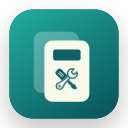

<p align="center"></p>

# SwitchBench

A Mac workbench for Switch game files. Update, check, combine, convert, split, join, and shrink files in one native app.

**Apple Silicon · macOS 13 or later · Free and open source**

[](https://github.com/cinderlatch/SwitchBench/actions/workflows/ci.yml)

[Download the latest release](https://github.com/cinderlatch/SwitchBench/releases/latest) · [User guide](docs/USER_GUIDE.md) · [Report a problem](https://github.com/cinderlatch/SwitchBench/issues/new/choose)

## Why SwitchBench exists

SwitchBench's primary inspirations are **[Switch Army Knife (SAK)](https://github.com/dezem/SAK)** by dezem and the SAK project team, and **[Switch Game Merge Utility](https://github.com/LordZeuss/switch-merge-utility)** by LordZeuss.

As a non-developer, I had difficulty getting Switch Game Merge Utility running on my Mac and running SAK in a virtual machine on my Mac. Some of that may have been down to my own inexperience, rather than problems with those tools. I worked with OpenAI Codex to build a native macOS app for these workflows, first called SwitchPatch and later expanded into SwitchBench.

I am grateful for the work those projects made available and the ideas they demonstrated. SwitchBench is a separately written native Mac app; no SAK or Switch Game Merge Utility application code is bundled here.

## Get started

1. Download `SwitchBench-v0.6.0-macOS-AppleSilicon.zip` from Releases and unzip it.
2. Move **SwitchBench.app** to Applications and open it.
3. Choose a tool, add your files, and review the preview. For tools that need keys, select your own emulator's `prod.keys` file.
4. Choose a save folder and start. Your originals stay unchanged; existing outputs are never silently replaced.

The download is locally signed, **not Apple-notarized**. macOS may block its first launch. After verifying that you downloaded the official release, follow Apple's [instructions for opening a Mac app from an unidentified developer](https://support.apple.com/102445). No Intel build is currently provided.

No games, firmware, production keys, or title keys are included. Use only files and keys you are authorized to use. This project does not provide download sources for them.

## Seven tools, one workflow

| Tool | What it does |
| --- | --- |
| **Update Games** | Applies a matching update and creates an updated NSP copy. |
| **Check Files** | Shows game names, versions and included content, then checks for missing or changed data. Works with batches and folders. |
| **Combine Files** | Keeps one game, its matching update and add-ons together in one NSP. The update remains separate inside the package. |
| **Convert to NSP** | Creates NSP copies from XCI, NSZ and XCZ files. Compressed files are expanded. |
| **Split Large Files** | Creates smaller parts for drives with a file-size limit, with a parts list and checksums. |
| **Join Split Files** | Puts supported file parts back together and checks the result. |
| **Shrink XCI Files** | Removes unused trailing space from uncompressed XCI files. |

Every tool provides preparation, clear results and recovery beside the affected file. Save folders are remembered separately. **Recent Results** helps find completed files after reopening; **Use File In…** hands a result to a useful next tool. A standard NSP or already-small/trimmed file shows **No Change Needed**.

**Update vs Combine:** Update applies the update to the game content. Combine puts the original content together in one package. Choose Update when you need an updated standalone copy.

## Requirements and limits

- Apple Silicon Mac, macOS 13+. An emulator is not required to process files.
- Your own compatible `prod.keys` for Update, Check and Combine. Additional title keys are requested only when needed. Keys remain local.
- Enough free space for the output and temporary work. Preparation shows available space and known estimates.
- Update currently supports matching single-program game/update pairs; it does not apply DLC or multi-program patches.
- A successful data check **does not prove emulator compatibility or gameplay**, and does not authenticate Nintendo signatures. Rebuilt updates cannot retain original Nintendo signatures.
- Supported inputs include NSP, XCI, NSZ and XCZ, with format-specific limits. There is no compression-output or NSP-to-XCI tool.
- Older split sets without source checksums can be checked for structure/missing parts, but cannot be compared against an authoritative original checksum.

See [the user guide](docs/USER_GUIDE.md), [troubleshooting](docs/TROUBLESHOOTING.md), [privacy](PRIVACY.md), and [validation and limitations](QA-UAT.md).

## Build from source

Install Apple's Command Line Tools (`xcode-select --install`) and use an Apple Silicon Mac:

```sh
git clone https://github.com/cinderlatch/SwitchBench.git
cd SwitchBench
bash build.sh
bash test.sh
```

The app is created at `build/SwitchBench.app`; a distributable ZIP is created in the repository root. The build uses bundled source and macOS frameworks; Homebrew, Python and a separate runtime compression tool are not required. Builds are locally signed. See [development notes](docs/DEVELOPMENT.md) for optional large-file/network checks and release steps.

## Upstream projects and acknowledgements

SwitchBench builds upon software created by the developers and upstream projects acknowledged below. They did not necessarily participate in SwitchBench’s development, review it, or endorse it. References to an upstream project’s authors or contributors refer to their work on that project, not direct contributions to SwitchBench.

The native app relies on the following upstream work:

- **SciresM and the hactool project** — archive inspection, extraction, patch materialization and verification (ISC).
- **The-4n, DarkMatterCore and the hacPack project** — archive rebuilding (GPL-2.0, with retained upstream notices).
- **The Mbed TLS project** — cryptography bundled by the helpers (Apache-2.0).
- **Meta/Facebook and the Zstandard project** — native compression decoding (BSD license).
- **nicoboss and the NSZ project** — public format documentation used as a reference.

See [CREDITS.md](CREDITS.md), [THIRD_PARTY_NOTICES.md](THIRD_PARTY_NOTICES.md), and [Vendor/CHANGES.md](Vendor/CHANGES.md) for links, retained licenses and local modifications. Upstream names do not imply endorsement.

SwitchBench's original source is offered under **GPL-2.0-only**; bundled third-party code retains its own licenses. See [LICENSE](LICENSE) and [COPYRIGHT.md](COPYRIGHT.md). Full modified helper sources are included.

## AI involvement

SwitchBench was developed with **substantial assistance from OpenAI Codex**, including implementation, tests, documentation and UX work, under human direction. This is a disclosure of the development process, not an independent quality endorsement. See [AI_DISCLOSURE.md](AI_DISCLOSURE.md) for scope, validation and limits.

## Participate

Bug reports, reproducible cases, usability feedback, documentation and code contributions are welcome. Start with [CONTRIBUTING.md](CONTRIBUTING.md), [SUPPORT.md](SUPPORT.md), [SECURITY.md](SECURITY.md), and the [Code of Conduct](CODE_OF_CONDUCT.md). Never attach game content, keysets or unredacted personal logs to public issues.

SwitchBench is independent and is not affiliated with Nintendo, Apple, OpenAI, Eden, or the credited upstream projects. Switch and Nintendo are trademarks of their respective owners.
